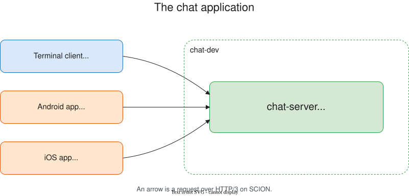
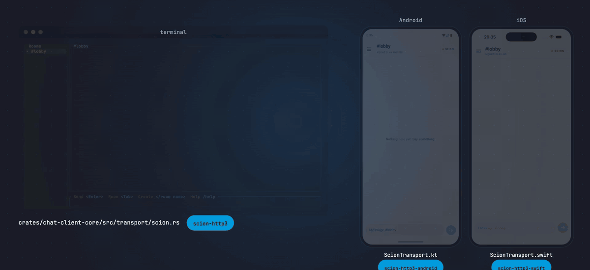
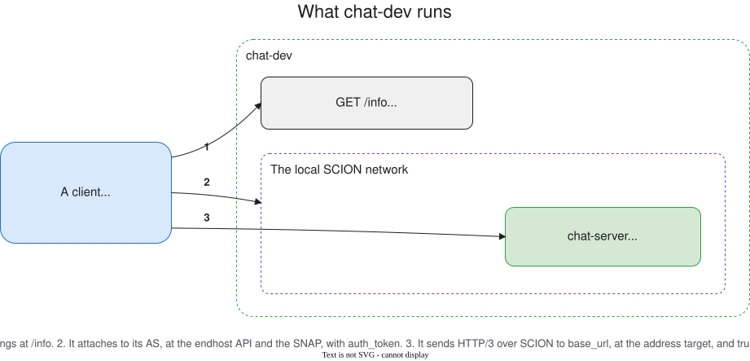
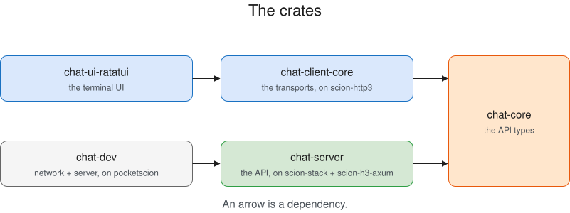
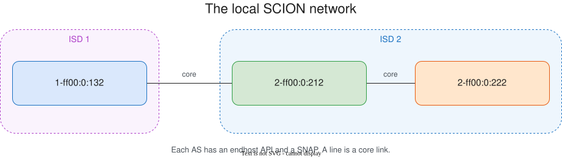

# scion-sdk-chat

A chat over SCION, built with the [SCION SDK](https://learn.anapaya.net/docs/academy/scion-sdk/).
One server, three clients:

- a terminal client
- an Android app
- an iOS app

Every request between a client and the server is HTTP/3 over SCION.



## Where the SDK is

One file for each role:

| role | file |
| --- | --- |
| a client, in Rust | [`transport/scion.rs`](crates/chat-client-core/src/transport/scion.rs) |
| a client, on Android | [`ScionTransport.kt`](android/chat-client/src/main/kotlin/com/anapaya/chat/client/ScionTransport.kt) |
| a client, on iOS | [`ScionTransport.swift`](ios/ChatClient/Sources/ChatClient/ScionTransport.swift) |
| the server | [`scion.rs`](crates/chat-server/src/scion.rs) |
| a SCION network on this machine | [`topology.rs`](crates/chat-dev/src/topology.rs) |
| all of the above, in one test | [`tests/scion.rs`](crates/chat-client-core/tests/scion.rs) |

The three clients are structurally identical. Only the language changes.

The three calls that each client makes into the SDK, with the SDK names in bold:

| | terminal client (Rust, `scion-http3`) | Android (Kotlin, `scion-http3-android`) | iOS (Swift, `scion-http3-swift`) |
| --- | --- | --- | --- |
| configure | <code>let mut settings = <b>Config</b>::<b>new</b>(config.endhost&#95;api.clone());</code> | <code>val client = <b>ScionHttp3Client</b><br>.<b>Builder</b>(context)<br>.<b>endhostApi</b>(config.endhostApiUrl)</code> | <code>var settings = <b>ScionHttp3Client</b>.<b>Configuration</b>(endhostApi: config.endhostApiUrl)</code> |
| build | <code>client: <b>Client</b>::<b>new</b>(settings),</code> | <code>.<b>build</b>()</code> | <code>client = try <b>ScionHttp3Client</b>(configuration: settings)</code> |
| send | <code>let reply = self.client.<b>request</b>(outgoing).await.map&#95;err(failure)?;</code> | <code>client.<b>newCall</b>(built).<b>execute</b>()</code> | <code>let response = try await client.<b>execute</b>(built)</code> |

The server, on `scion-stack` and `scion-h3-axum`:

| | the server (Rust) |
| --- | --- |
| configure | <code>let mut builder = <b>ScionStackBuilder</b>::<b>new</b>().<b>with&#95;endhost&#95;api</b>(endhost&#95;api);</code> |
| build | <code>builder.<b>build</b>().await</code> |
| serve | <code>let socket = stack.<b>bind</b>(Some(bind&#95;addr)).await<br><b>ScionH3AxumServer</b>::<b>serve&#95;with&#95;graceful&#95;shutdown</b>(…)</code> |



## Run it

Two terminals:

- one terminal starts a SCION network with the chat server in it
- another runs a terminal client that talks to the server over SCION

### 1. Start the network and the server

```sh
cargo run -p chat-dev
```

This command starts:

- the SCION network
- the chat server
- a control API that describes both

Ctrl+C stops all of it.

### 2. Connect a terminal client

`chat-dev` serves its description on a fixed port, 8099. The values in it change with each run:

- the endhost API takes a free port
- the SNAP token is new for each run
- the certificate goes in a new directory



Read them into the environment, then start the client:

```sh
eval "$(curl -s http://127.0.0.1:8099/info | jq -r '
  "export CHAT_CLIENT_SERVER_URL=\(.base_url | @sh)",
  "export CHAT_CLIENT_ENDHOST_API=\(.endhost_api_url | @sh)",
  "export CHAT_CLIENT_TARGET=\(.target | @sh)",
  "export CHAT_CLIENT_CERT_PATH=\(.ca_path | @sh)",
  "export CHAT_CLIENT_SNAP_TOKEN=\(.auth_token | @sh)"
')"

cargo run -p chat-ui-ratatui
```

For another user, run the same two commands in another terminal. Each read of `/info` makes a new
token, and each client needs its own.

### 3. Connect a phone

The Android app runs on an emulator on this machine:

```sh
cd android && ./gradlew :app:installDebug
```

The app is pre-filled with `10.0.2.2:8099`, which is the address the emulator reaches this host's
loopback at. The first build downloads the SDK into `android/libs/maven`. See
[android/README.md](android/README.md).

The iOS app runs on a simulator on this machine:

```sh
cd ios && ./fetch-sdk.sh && xcodegen generate && open ChatApp.xcodeproj
```

The app is pre-filled with `127.0.0.1:8099`. The simulator shares the Mac's network, so that is the
same address outside it. `fetch-sdk.sh` downloads the SDK into `ios/libs`. See
[ios/README.md](ios/README.md).

Every client shares the rooms. A message from the terminal client appears on the phone.

### From another machine

`--bind-ip` moves every part of the network to one address that another machine reaches. Give a real
address on this machine:

```sh
cargo run -p chat-dev -- --bind-ip 192.168.1.20
```

Every client then uses that address, this machine included, so you give up the name `localhost`.
See [the topology](#the-topology) for which AS each client attaches to.

## The crates



`cargo doc_dx --open` renders every crate.

`android/` and `ios/` are separate builds. Each one reaches the same server over the SCION SDK for
its platform, and each one has a README that lays out its code.

### chat-core

The API's request and response types. Both the server and the client depend on it, so a change
reaches both.

### chat-server

The server. `cargo run -p chat-server -- --help` lists every flag with its default and its `CHAT_*`
environment fallback.

[`scion.rs`](crates/chat-server/src/scion.rs) puts it on SCION in three steps:

- `ScionStackBuilder` builds a stack
- `stack.bind()` opens a socket on it
- `ScionH3AxumServer::serve_with_graceful_shutdown` serves the Axum router on that socket

The SNAP asks the server to prove that it may use the network, as it asks every client. The server
answers with 1 of 2 flags:

| flag | environment | what it is |
| --- | --- | --- |
| `--auth-api-key-file` | `CHAT_AUTH_API_KEY_FILE` | a file with an API key. The AA exchanges it for tokens for as long as the server runs |
| `--auth-token-file` | `CHAT_AUTH_TOKEN_FILE` | a file with 1 token. The server stops working when the token expires |
| `--aa-url` | `CHAT_AA_URL` | the AA for `--auth-api-key-file`. Defaults to `https://auth.scion.anapaya.net` |

With neither flag, the server sends no token. Only an endhost API that asks for no token accepts
that.

#### Endpoints

Every route sits under `/api/v1`. Every route needs an `authorization: Bearer <token>` header, with
the token from `login`, except:

- `/healthz`
- `/server`
- `/register`
- `/login`

The server describes itself at `/.well-known/openapi.json`. The repository also holds the same
document as YAML at [`crates/chat-server/openapi.yaml`](crates/chat-server/openapi.yaml), because
YAML gives a better diff. You can therefore read and review the API surface without a running
server. A test compares the two documents, and it rewrites the file when you run:

```sh
CHAT_UPDATE_OPENAPI=1 cargo test -p chat-server
```

### chat-client-core

The typed API, the session, and the transport under them:

- `ScionTransport` carries HTTP/3 over SCION, against the server's `--transport scion` mode
- `TcpTransport` speaks plain HTTP to the server's `--transport tcp` mode
- `MockTransport` answers from a script, so a test can produce a reply that no real server produces

`tests/scion.rs` starts a network of two ASes, puts the server in one and a client in the other, and
sends a message between them.

### chat-ui-ratatui

Three screens over `chat-client-core`:

- connect
- sign in
- chat

The screens draw and read keys. `app.rs` holds every call to the client.

Every field of the connect screen also has a flag, so a launch can arrive with the form answered:

| flag | environment | what it is |
| --- | --- | --- |
| `--transport` | `CHAT_CLIENT_TRANSPORT` | `scion` or `tcp`. Defaults to `scion` |
| `--server-url` | `CHAT_CLIENT_SERVER_URL` | where the server is |
| `--endhost-api` | `CHAT_CLIENT_ENDHOST_API` | how the client finds SCION. Required by `--transport scion` |
| `--target` | `CHAT_CLIENT_TARGET` | the server's SCION address, for a host with no TSAR record |
| `--cert-path` | `CHAT_CLIENT_CERT_PATH` | a certificate to trust instead of the system roots |
| `--insecure` | `CHAT_CLIENT_INSECURE` | accept any certificate. See [Trust](#trust) |
| `--auth-api-key` | `CHAT_CLIENT_AUTH_API_KEY` | a key the AA service exchanges for tokens. See [Credentials](#credentials) |
| `--snap-token` | `CHAT_CLIENT_SNAP_TOKEN` | a token, as `chat-dev` hands out. See [Credentials](#credentials) |
| `--aa-url` | `CHAT_CLIENT_AA_URL` | the AA (Authentication and Authorization) service, the token issuer for Anapaya's network. Defaults to `https://auth.scion.anapaya.net` |

Each transport uses one URL scheme:

- `scion` uses `https`
- `tcp` uses `http`

The client checks the URL against the transport.

#### Credentials

The SNAP asks every client to prove it may use the network. There are two ways to answer, and the
clients offer the choice the same way they offer [Trust](#trust):

| choice | flag | what it is |
| --- | --- | --- |
| API key | `--auth-api-key` | the long-lived secret. The AA service exchanges it for tokens |
| SNAP token | `--snap-token` | one token, already minted |

A token expires, so a client given only a token stops working at that moment. A client given a key
hands it to the SDK, which exchanges it for a token when the client is built and renews that token
for as long as the client runs. For local development, `chat-dev` takes the place of the AA service:
each read of `/info` returns a newly minted token.

#### Trust

Every client accepts the server's certificate in one of three ways. The terminal client chooses with
the flags above, and the two apps with a control on the configuration screen:

| choice | flag | what it accepts |
| --- | --- | --- |
| system roots | neither flag | the anchors the machine ships |
| pinned | `--cert-path` | one certificate, in place of those anchors |
| no check | `--insecure` | any certificate at all |

The default is the strict one, so a blank `--cert-path` means the system roots and a self-signed
server is refused. `--insecure` says so on purpose. It exists to reach a server you control before
you have copied its certificate, and while it is on, anyone on the path can answer as that server.
Giving both flags is refused, because they name different trusts.

The client reads `CHAT_CLIENT_*` and the server reads `CHAT_*`. Keep them apart. The server sits in
one AS and the client attaches to another, so a shared `CHAT_ENDHOST_API` would point the client at
the wrong endhost API.

### chat-dev

A development helper. It starts a SCION network on this machine and puts the chat server in it. The
network runs for as long as the process runs. The underlay is SNAP, which addresses an endpoint at
the address its tunnel observed. A client behind a translation needs that.

#### The topology

The network holds three autonomous systems. The server's AS is the middle one.



| AS | who attaches to it | published at |
| --- | --- | --- |
| `1-ff00:0:132` | every client, and the default | the bound address |
| `2-ff00:0:212` | the chat server | the bound address |
| `2-ff00:0:222` | an Android emulator on this machine | `10.0.2.2` |

`1-ff00:0:132` is the default AS. It publishes the address that `--bind-ip` binds, and every client
that reaches that address uses it:

- a terminal client on this machine
- a client on another machine, after you give `--bind-ip` an address that machine reaches

An Android emulator on this machine is the only client that cannot use the default. The emulator
reaches the host at `10.0.2.2`, and inside the emulator `127.0.0.1` means the emulator itself. The
network publishes one address for each AS, and one AS holds one address, so the emulator gets
`2-ff00:0:222` as a fallback. `--bind-ip` makes the fallback unnecessary: with a LAN address bound,
the emulator reaches that address like any other client.

Two files build this:

- [`topology.rs`](crates/chat-dev/src/topology.rs) makes the three ASes, the two links, and the
  endhost API and SNAP endpoint in each
- [`lib.rs`](crates/chat-dev/src/lib.rs) sets the address each AS publishes, and chooses the
  description that `GET /info` answers with

#### The description

`chat-dev` serves its description at `GET /info` on `--control-port` (8099), over plain TCP. A
client that failed to connect over SCION can still read it. The same document goes to standard
output at startup.

```sh
curl -s http://127.0.0.1:8099/info | jq
```

```json
{
  "control_url": "http://127.0.0.1:8099",
  "endhost_api_url": "http://127.0.0.1:65263/",
  "client_isd_as": "1-ff00:0:132",
  "auth_token": "eyJ0eXAiOiJKV1Qi...",
  "base_url": "https://localhost:8443",
  "target": "2-ff00:0:212,127.0.0.1",
  "ca_path": "/tmp/.tmpTFIcwA/cert.pem",
  "chat_server_args": ["--transport", "scion", "--listen", "127.0.0.1:8443", "..."]
}
```

This sample shows the fields a client reads most. The document holds more. Every field carries a
doc comment in [`info.rs`](crates/chat-dev/src/info.rs), which `cargo doc_dx` renders.

`GET /info` answers with the description that matches the address the client asked at:

- a request to `10.0.2.2` gets the emulator's AS
- every other request gets the default AS

Both descriptions name the same server, certificate and SCION address.

#### Running the server yourself

`--no-server` starts the network without the chat server:

```sh
cargo run -p chat-dev -- --no-server
```

`cargo run -p chat-server` then starts the server as its own process against the running network.
You can stop it, rebuild it and start it again while the network stays up. The `chat_server_args`
field holds the command that joins it:

```sh
cargo run -p chat-server -- $(curl -s http://127.0.0.1:8099/info | jq -r '.chat_server_args | join(" ")')
```

Give the server the same data directory, so it presents the certificate the description names.

## Development

The pinned toolchain in `rust-toolchain.toml` is picked up automatically by rustup. CI runs the
checks the cargo aliases in `.cargo/config.toml` define, on Linux and Windows:

```sh
cargo clippy_ci
cargo test_ci
cargo doc_ci
```

Formatting runs on a pinned nightly, because `rustfmt.toml` uses nightly-only options:

```sh
cargo +nightly-2026-03-12 fmt --all
```

The SDK leaves the choice of a rustls provider to the application. Every binary here calls
`scion_sdk_utils::rustls::select_ring_crypto_provider()` before its first TLS handshake.

### The database

SQLite is compiled into the binary, so there is no database service to install, start, or connect
to. The database is one file. The store creates the file and the directory that holds it. Delete the
file to start over.

### The `.sqlx` folder

The compiler checks the server's SQL against the schema, so it needs to know the schema.
`crates/chat-server/.sqlx/` holds that knowledge, as one JSON file for each query.

The repository commits this folder, so a build needs no database and no tooling. Every cargo
command works on a fresh clone without `DATABASE_URL` or `sqlx-cli`. The crate fails to compile
without the folder.

You need `sqlx-cli` to add or change a query. Regenerate the metadata afterwards:

```sh
cargo install --version 0.9.0 sqlx-cli --no-default-features --features sqlite  # match Cargo.toml
cd crates/chat-server
DB=$(mktemp -d)/prepare.db   # a fresh file: CREATE TABLE IF NOT EXISTS would keep a stale one
sqlite3 "$DB" < src/store/sqlite/schema.sql
DATABASE_URL="sqlite://$DB" cargo sqlx prepare -- --all-targets
```

A forgotten regeneration is a compile error. Metadata that has drifted from the schema is worse,
because it still compiles, so CI runs the same commands with `--check`.

## License

Licensed under the [Apache License, Version 2.0](LICENSE).
